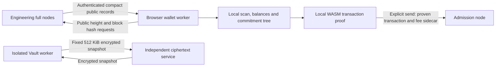

# Native V1 browser wallet

Status: local engineering light-sync, browser-proving and independent encrypted
Vault implementation. Public deployment, independent review and phone send
measurements are incomplete. Existing native CLI interfaces are preserved.

## Recovery and local custody

Recovery uses exactly 24 canonical English BIP39 words encoding the original
256-bit entropy. It does not use the BIP39 PBKDF2 seed or an optional BIP39
passphrase. Native network ID and unsigned 32-bit account index bind all existing
key-derivation domains. A phrase restored with a different context produces a
different identity; the original context must be retained with the backup.

The implementation reuses the frozen KoalaBear/Poseidon2 field hash and pinned
ML-KEM-768 implementation. Integration tests compare the portable identity to
the existing native wallet across networks, accounts and synthetic entropies.
No circuit, proof, reward, maturity or consensus parameter is modified.

New entropy comes from browser cryptographic randomness inside a dedicated
worker. Three distinct randomized word positions must be answered before
encrypted persistence or usable receiving information. Cancel, lock, page exit and
backgrounding clear recovery fields and terminate the worker. A five-minute
inactivity timeout also locks the session. Strings copied by the browser or
JavaScript engine cannot be guaranteed to have been erased; compromised scripts,
extensions, the device and recovery screenshots remain outside this boundary.

The binary vault is the existing 132-byte SWNVLT01 format: magic, 16-byte salt,
24-byte nonce, authenticated 68-byte payload and 16-byte tag. The payload is
network (32), little-endian account (4), and entropy (32). Argon2id v19 uses
65,536 KiB, three iterations and one lane. XChaCha20-Poly1305 authenticates the
native domain string and the entire header. The device password does not affect
the receiving identity. Native and portable vaults authenticate each other.

IndexedDB stores ciphertext and public recovery context in a separate native V1
namespace. Adds are atomic and never replace an existing wallet. Backup parsing
is bounded, validates an exact schema and rejects legacy formats. The browser
authenticates network/account against the decrypted payload before importing a
backup. A seed vault export is not a native payment-journal backup; native tools
must retain existing payment journals and their reservations.

## Receiving interfaces

Canonical native receiving data remains 1,232 bytes: 48 bytes of canonical owner
fields and an independently validated 1,184-byte ML-KEM-768 public key. The public
version-1 descriptor keeps exactly `version`, `network`, `account`, `address_hex`.
No recovery phrase, private key, device password or view secret is exported to
the miner.

The proposed text encodings are interfaces above consensus. They use lowercase
RFC 4648 base32 without padding. The full form has prefix `sivf1` and a payload
containing version byte 1, network ID (32), and recipient bytes (1,232). The short
form has prefix `sivs1` and payload version byte 1 plus a 32-byte directory
commitment. The short string has 71 characters; the full string has 2,042.

Both forms append an eight-byte BLAKE3 checksum before base32 encoding. Its
derive-key domain is `siworld native recipient text checksum v1`, followed by
prefix, expected network and payload. The directory commitment uses domain
`siworld native recipient directory v1`, followed by network and recipient bytes.
Parsers reject noncanonical trailing bits, mixed/uppercase text, wrong networks,
bad checksums, noncanonical owner fields and invalid encapsulation keys.

The receiving UI provides full text and short text for the same native recipient. Miner setup accepts a single address field; users do not need a JSON descriptor or contact file. Full addresses use the portable wallet codec locally and need no directory. Short addresses authenticate an independently obtained full address through their network-bound commitment; they do not compress an ML-KEM public key.

A short address can be enabled explicitly by publishing only its matching public full address to the engineering directory. No automatic publication occurs. The directory contains no recovery words, private keys, viewing keys, account indices or Vault identifiers. Browser and miner verify the returned full address locally. Missing, malformed, wrong-network or substituted entries fail explicitly. Full addresses remain usable when the directory is unavailable.

The directory has no chain database, transaction admission or node control authority. It is a separate capability from the read-only compact-data API, even when hosted on the same independent wallet server. The operator can transiently observe the public receiving address, lookup and source IP, including correlations across routes on that host. Raw access logs and exported request metadata must be disabled; this does not provide network-level anonymity. Production directory and miner-adapter deployment remain incomplete until separately activated. These text encodings require independent review before mainnet use.

## Scope and trust model

Only `siworld-eng-1` is enabled. Recovery words, private/view/change keys, notes and full
spending witnesses remain in the browser. Transactions are proved locally in
WASM. The browser does not download or verify complete historical transaction,
settlement or issuance proofs and does not independently establish transaction
validity. It trusts the engineering full-node consensus for that validity.

Select the observed header-valid branch with greatest cumulative verified
work, not merely greatest height. Verify the pinned genesis/network/profile,
parent continuity, height, PoW, ASERT target and median-time rules. An
invalid-transaction branch with valid work is outside this lightweight trust
model; independent full nodes must reject it. Multiple sources help detect
withholding but do not establish validity or global availability.

## Data flow

No wallet address, view key, view-tag filter, owned nullifier, balance or
private recovery material is sent to a chain-data server. Every wallet
requests the same whole compact block records. Read services provide public
data only. Admission separately receives the proven transaction and the
native 78-byte fee-opening sidecar. The admission recipient learns its fee
opening and can associate submission with source IP/timing. This disclosure
is retained, not hidden by the website. No new sidecar crypto or anonymity
claim is introduced. Public APIs/logs must not publish sidecars or user-linked
IP/nullifier timing. Use direct HTTPS without an unreviewed third-party TLS
terminator.

## Existing header commitment and compact integrity

The current wire format has no independent output/ciphertext/nullifier Merkle
roots and no standalone SPV header. `Block::pow_seed` hashes every canonical
block byte except the nonce, using BLAKE3 derive-key mode and domain
`siworld native engineering pow seed v2`. `Block::id` commits to this seed and
the nonce. Thus the existing worked hash commits to compact data indirectly,
including metadata and framing, but a supplied seed alone does not prove that
supplied header fields or compact records are its preimage.

Without authenticated selective-disclosure proofs, **a node can conceal notes
from the wallet**, substitute compact fields or misrepresent parent/target
metadata. Comparing JSON responses is not a cryptographic repair.

The local engineering adapter uses BLAKE3's existing tree structure to prove
selected byte ranges against the original worked seed. This adds an application
response format, not a new block root, proof relation or consensus rule:

- Disclose all header bytes, every transaction's canonical public prefix,
  both sender-change ciphertexts, reward outputs, fund records, signed issuance
  public records, and their authenticated length/count framing.
- Replace undisclosed full-proof subtrees with BLAKE3 chaining values. Disclose
  boundary chunks as needed; they may include small adjacent proof fragments,
  never complete transaction/settlement proofs in ordinary capped blocks.
- Use standard 1,024-byte BLAKE3 chunk boundaries and correct derive-key context,
  chunk offsets, canonical tree shape and root flag. Check root against the
  seed and seed/nonce against the block identity and PoW.
- Parse expected positions from authenticated framing, never a server-selected
  list of owned outputs. A missing required chunk fails the entire block;
  it cannot be interpreted as an empty result. Locally derive commitment-tree
  state from all canonical outputs and reconcile all public nullifiers.
- Limit response bytes, tree nodes, preimage length and allocation before use.

This range verifier needs adversarial tests against the standard whole-input
BLAKE3 output and independent review before a mainnet claim. It authenticates
bytes of the selected worked block, not full-node transaction validity. A node
can still withhold whole blocks or a newer chain. Mainnet alternatives for
review are dedicated consensus-committed roots/counts for compact output,
ciphertext and nullifier records, plus authenticated tree-state witnesses,
or a reviewed standardized outboard proof format for the existing hash.
This task implements neither a consensus-format change nor a mainnet launch.

## Synchronization and spending state

The opt-in native gateway serves immutable compact binary blocks and bounded
header/index batches from committed native history. Its private Unix socket
requires an account-owned mode-700 parent and a mode-600 endpoint. The native
canonical-state owner handles at most one queued IPC request per turn, using
the unchanged native admission path. A bounded loopback HTTP reference adapter
provides exact CORS, request limits and no access logging. No Internet service
is enabled by the local implementation. Cold compact archival runs on the
canonical owner and needs latency review before a deployed service; failures
do not change consensus and incomplete availability is reported separately.
The adapter never exposes the
host-owning loopback wallet server or its wallet paths. No remote scan or
prover endpoint exists. Chain reads contain no fee sidecars or full proof
bodies. A node export/outboard index may be prepared while full blocks are
available; persist compact data and its authentication paths independently
when required for historical service.

A production submission capability is separately opt-in through
`SIWORLD_WALLET_SUBMIT_SOCKET`. It accepts only operation 3 (an original native
transaction envelope followed by its private fee sidecar); read and control
operations are rejected. It retains the mode-700 parent, mode-600 socket,
four-connection/request bounds and original admission checks. Do not configure
the reference `SIWORLD_WALLET_GATEWAY_SOCKET` simultaneously. Optional
`SIWORLD_WALLET_PUBLIC_EXPORT` may run alongside submission in an independent
export directory. Export initialization or write failures do not grant read
capabilities or disable submission. Submission alone does not index history.
No TCP listener is created and this configuration does not enable a remote
HTTP service. An outbound relay requires independent authentication and
resource controls before activation.

Historical transaction proofs and their three-day pruning window are no
longer browser synchronization inputs. Missing historical proofs do not
require a wallet checkpoint and do not block readiness. The remaining
requirements are all public historical ciphertexts/nullifiers/commitments and
valid header/range-authentication material. If an implementation prunes full
block bytes without retaining the required BLAKE3 outboard authentication
nodes, it cannot reconstruct those nodes from compact bytes alone. This is
a compact-service indexing/retention dependency, not a need to restore or
verify deleted transaction proofs. Detect and report missing compact history;
never silently skip it. Do not extend full-proof retention for the wallet.

Scan every recipient, both change outputs, rewards, fund withdrawals and
issuance outputs locally. The recipient view tag is checked after ML-KEM
decapsulation; it saves AEAD work, not download bytes or KEM work. Reconstruct
owned note commitments and nullifiers locally. Keep integer amounts and
verified-by-header height/tip plus explicit full-node-consensus trust labeling.
Display confirmed, locked, mature, reserved and pending balances separately.
An incomplete/disconnected scan preserves the previous value as stale, never
reports an unexplained zero.

Derive the local commitment tree and depth-12 recent-root window using the
native tree/order rules. This supplies the local spending witness and avoids
sending owned leaf/path requests to a server. The local adapter is explicitly
separate from full-node `State::apply`; it must never be used as a consensus
validator. Test derived roots and wallet receipts against native fixtures.
Reorgs build and scan a candidate state and replace accepted state only after
header/work/compact checks and atomic durable storage; reservations survive
reorgs and crashes. A greater-work candidate must not overwrite accepted state
partway through a failed sync.

Retain only an incremental depth-40 commitment frontier, paths for positive
owned notes, relevant owned nullifiers and the bounded recent-root window;
do not retain all public leaves/nullifiers in browser RAM. Replay persisted
compact blocks one at a time, retaining only their index in RAM. Compare owned
paths and roots with the original full-tree implementation.

Use one bounded fetch/worker queue, cross-tab locks and encrypted private
records/journal. The journal key is domain-separated from wallet entropy,
network and account; it is not a Vault credential. Local lookup keys derived
from public addresses never leave local storage. This engineering journal has
a 16-payment tracking bound and a 5,000-owned-path bound; limits fail closed. Public compact caches may be persisted separately. Storage
quota or malformed/incomplete history prevents spending until resolved.
Poll small head metadata every five seconds while visible, with no duplicate
requests and backoff while hidden/offline; do not redownload unchanged blocks.

SIP ordinary/priority send uses validated full addresses or locally imported
authenticated short-address resolution, native two-input selection and unlock/fee rules,
durable input reservation, locally self-checked outputs, protected payment
opening, local WASM proving and local verification of that newly generated
proof. Persist the exact finalized packet before explicit transmission.
An acknowledgment means pending; timeout means unknown, so reconcile and
retry the same packet rather than create another payment. No background
consolidation or engineering privacy delay is enabled. All existing asset
balances are scanned; unimplemented asset-send actions remain unavailable.

## Bandwidth and elapsed time

The previous 11–98 GB/day full-proof model does not apply. The new budget
counts compact public prefixes and BLAKE3 range authentication, including
rounding to 1,024-byte boundary chunks and hidden-subtree chaining values.
Record both semantic payload bytes and actual encoded response bytes.
Measure 64-position engineering-like and 576-position full-capacity fixtures;
clearly distinguish these from actual live-chain traffic. Use 288 target
blocks/day; actual PoW rate, rewards, issuance and fund records vary.

First sync downloads the sum of compact responses through the observed tip.
Daily sync downloads only newly produced blocks; head polling is additional.
Report wire bytes, response sizes and measured browser scan time, separately
from ideal transfer time at 10/100 Mbps. Never present a localhost transfer
rate or a model as a public-internet measurement. The measurements below distinguish wire size, browser computation and
conditional transfer estimates.

### Local desktop measurements

The following measurements use disposable synthetic header-valid histories,
not full transaction-valid chains or live traffic. The machine was an Apple
M1 Max with 10 cores and 32 GiB RAM, using desktop Chrome 156 in headless mode.
No historical proofs were downloaded or verified. Each history contains 288
blocks, five Holder outputs per block, no issuance/fund withdrawals and only
one owned positive note. All public outputs were authenticated and scanned.
Fixtures use zero extra PoW hash iterations; the deployed profile uses 64,
whose additional overhead is not measured here. No transport compression is assumed; response bytes include range proofs and
boundary chunks. Real block production and record mixes change the totals.

| Positions | Compact bytes/block | Bytes/288 blocks | Browser authentication/scan | Last-block extension scan |
| --- | ---: | ---: | ---: | ---: |
| 64 | 231,513 | 66,675,744 | 16.903 s | 58.5 ms |
| 576 | 2,037,743 | 586,869,984 | 128.871 s | 440.9 ms |

At 288 target blocks/day these response totals are approximately 66.68 MB/day
and 586.87 MB/day. Head/index requests, HTTP/TLS overhead and retries are extra.
The engineering-like 64-position case models the present record mix; it is
not a measurement of a deployed public endpoint. First synchronization through
height H downloads the sum of H compact responses. Existing caches avoid
unchanged downloads; daily synchronization retrieves only newly produced data.

For one day of history, ideal transfer time is 53.34/469.50 s at 10 Mbps or
5.33/46.95 s at 100 Mbps (64/576 positions respectively). Adding the measured
scan cost gives conditional one-day estimates of about 70/598 s at 10 Mbps,
or 22/176 s at 100 Mbps. These are transfer-plus-scan models, not observed
Internet end-to-end durations. Longer first synchronizations need their own
scan measurements: retained owned notes and recent-root state affect cost.
Scan-only WASM high-water allocations were 5,439,488/7,929,856 bytes. They do
not include browser process memory or transaction proving.

The unchanged prover plus original-verifier self-check took 21.793 s for an
ordinary transaction and 20.920 s for a priority transaction. Proof sizes were
573,712 and 585,712 bytes. WASM linear-memory high-water was 512,360,448 bytes.
A separate 200 ms process sampling pass observed renderer RSS of 960,888,832
bytes and dedicated Chrome process-tree RSS sum of 1,481,080,832 bytes. RSS
sums can double-count shared pages and sampling can miss short peaks; these
are not exact physical-memory or kernel high-water measurements. Phone
sending remains disabled pending measurements on physical devices.

## Browser prover and measurement gate

Compile the unchanged frozen transaction relation to WASM and use the pinned
native verifier artifacts. A browser-only adapter can initialize transaction
preprocessing without initializing the miner's settlement prover. It does not
alter AIR, parameters, statement or verifier keys. Newly generated proof bytes
must verify with the original native verifier. If proof-source changes become
necessary, report their scope before editing them.

Measure actual desktop-browser cold setup and ordinary/priority transaction
proof generation time, proof size, WASM high-water allocation and complete
renderer/process peak. JS heap or linear memory alone is not a process peak.
Use disposable local fixtures and keep witnesses on the device. Physical
Android/iOS measurements are required before enabling phone send; emulated
screens do not qualify. Do not weaken native limits or offload proof generation
if the browser is slow or runs out of memory. Existing native qualification
runs are not repeated unless proof-related source changes require them.

### Optional SIMD and threaded local measurements

Chrome 156 on two physical desktops measured the same synthetic 64-slot
compact fixture and one ordinary plus one priority proof per build. Each
duration includes generation and the unchanged verifier code compiled to WASM.
These are individual samples, not latency percentiles or hardware qualification.

| Measurement environment | Build | Actual threads | Ordinary (s) | Priority (s) | WASM high-water (MiB) | Renderer RSS peak (MiB) | Browser RSS sum peak (GiB) |
| --- | --- | ---: | ---: | ---: | ---: | ---: | ---: |
| Apple M1 Max / 32 GiB | Baseline | 1 | 26.25 | 21.67 | 488.56 | 977.02 | 1.471 |
| Apple M1 Max / 32 GiB | SIMD | 1 | 21.87 | 17.92 | 488.56 | 978.53 | 1.471 |
| Apple M1 Max / 32 GiB | SIMD + threads | 4 | 6.61 | 6.46 | 496.75 | 1005.89 | 1.498 |
| Apple M2 / 16 GiB | Baseline | 1 | 24.24 | 22.86 | 488.56 | 985.62 | 1.496 |
| Apple M2 / 16 GiB | SIMD | 1 | 18.74 | 22.01 | 488.56 | 988.34 | 1.507 |
| Apple M2 / 16 GiB | SIMD + threads | 4 | 5.70 | 5.20 | 496.75 | 1019.00 | 1.531 |

Builds use rustc 1.99.1, wasm-bindgen 0.2.120, size optimization and LTO.
The local thread experiment rebuilds the matching standard library with an
explicit bootstrap opt-in; it is not a production toolchain approval. SIMD
uses the existing dependency implementations. Four-thread builds use atomics,
bulk memory, mutable globals and imported shared memory under COOP/COEP.
AIR, parameters and verifier keys are unchanged. Each measured transaction
proof was at most 590,273 B, below the unchanged 655,360 B native cap.

RSS was sampled every 200 ms; shared pages may be counted more than once and
brief peaks may be missed. These are not exact physical-memory peaks.
Proof grinding, scheduling and thermal state can vary. The 8-core, 16 GiB
second desktop does not constitute a physical 4-core notebook or phone result.
Phone sending remains disabled. No real network transfer is included.

### Proving activity and estimates

The send dialog reports actual preparation, durable encrypted reservation,
proof-generation/local-verification and encrypted-packet-save boundaries.
A dedicated UI timer keeps elapsed time visible while the worker performs the
synchronous prover call. That call has no arithmetic progress callback: the
activity bar remains indeterminate, and only successful generation and local
verification complete it. An overrun remains in progress rather than displaying
an invented percentage. The first desktop timing is explicitly a reference;
subsequent remaining-time estimates use the last three successful proving
measurements in the current page session and are not saved with an identity.
Preparation transmits no transaction. Explicit review and exact-packet
submission remain separate actions. Closing and reopening the dialog preserves
in-flight activity; locking terminates the worker and clears the activity view
without discarding durable payment reservations.

The default build is single-threaded without explicit SIMD. Optional SIMD
uses the existing dependency implementations. Optional four-thread proving
uses the existing parallel backend, a rebuilt standard library, explicitly
imported shared memory and a pinned browser thread adapter. It requires COOP
`same-origin` and COEP `require-corp`; the threaded build fails explicitly
without isolation. Keep a separately built standard artifact for browsers
without this capability. Compilation features do not change AIR, proof
parameters, statements or verifier keys. The experimental shared memory has a
2 GiB maximum; this is not a reported process-memory peak.

## Vault: independent encrypted snapshot service

Vault is an off-chain backup service. There is no on-chain fee, transaction,
consensus receipt or V1 format change. Preserve the existing package animation;
show success only after the relevant local save or remote ciphertext commit.
Label local-only and online-synchronized states distinctly.

### Identity separation and authentication

Use a separate Vault application origin, storage namespace and service, with
the same existing visual style. The Wallet/Vault navigation opens that
isolated context with `Referrer-Policy: no-referrer` and no wallet-bearing
URL, window message, shared cookie or parent DOM access. It is not a shared
wallet-login session. Hosting/origin changes need a deployment review later.

Generate a Vault-only random account locator and independent random
Ed25519 authentication key in the Vault worker. Neither is derived from the
wallet mnemonic, receiving description, network/account number, local wallet
ID or a guessable passphrase. The service stores the locator and authentication
public key. The secret key is held only by the client and in its encrypted
offline recovery file. This application authentication choice does not
change node identity or consensus cryptography.

Authenticate each read/write with a domain-separated signature over the
service origin, random one-use server challenge, HTTP method, account locator,
expected revision and request-body digest. Challenges expire after at most
60 seconds and are consumed once. Avoid bearer secrets in URLs, shared
wallet cookies or reusable raw private-key uploads. A password is never sent
as a login credential. Account creation must prove possession of its new
authentication key; authenticated writes have strict byte/concurrency/quota
limits. The engineering rollout needs a bounded enrollment policy before
public exposure to prevent unlimited anonymous storage allocation.

### Encryption and fixed-size padding

Retain native-compatible local content packages (`SWNCNT01`, 4,160 bytes each)
and their current individual passphrases. The online snapshot uses an
independent sync passphrase to encrypt its index, package metadata and binary
encrypted packages. It does not upload the existing JSON wrapper containing
clear network/account fields.

The engineering capacity is at most 100 current-size packages, matching
the local item limit. Every snapshot, even an empty one, is exactly
524,288 bytes (512 KiB). There is one size class initially; a later larger
class requires explicit product/schema review and exposes its capacity class,
not an exact plaintext size. The fixed snapshot conceals current item count,
title/type/length, wallet network/account and which item changed.

Use Argon2id v19 with 65,536 KiB memory, t=3, p=1 and a 256-bit output;
use XChaCha20-Poly1305 with that 256-bit key, a fresh random 16-byte salt and
24-byte nonce per snapshot. A fixed 48-byte header plus encrypted
524,224-byte padded plaintext and a 16-byte AEAD tag totals 524,288 bytes.
Include format/domain, header, independent Vault locator and revision chain
in authenticated associated data. Encode actual lengths and padding only
inside the authenticated ciphertext. Reject noncanonical lengths, excess
counts, malformed padding or unknown profiles; never accept server-chosen
KDF work factors. This is a separate application sync format, not a new
wallet seed or chain format. Its byte layout has targeted encoding, tamper and recovery tests.

New encryption on every snapshot prevents ciphertext equality from revealing
unchanged content. Do not deduplicate across accounts, use plaintext-derived
cloud object names, compress before upload, or transmit per-item indexes.
Use a separate encrypted recovery-file domain and fresh salt/nonce for local
authentication credentials and account locator. Passphrase quality still
matters because stolen ciphertext permits offline guessing.

### Remote state, concurrency and recovery

The server stores only an opaque random locator, authentication public key,
fixed-size ciphertext versions, signed revision/previous-digest records,
ciphertext digests and operational quota metadata. It does not store a wallet address,
network account number, email, content name/type/length, plaintext, password,
private key, decrypted balance or wallet activity. Do not persist request
bodies/short-lived request authentication proofs/IPs in logs. Durable signed
revision records authorize ciphertext versions; they contain no wallet data.
TLS endpoints can observe network
metadata during a connection even when logging is disabled.

Use compare-and-swap on the expected prior revision/digest and client-signed
updates. Retain the previous accepted ciphertext on conflicts; the client
decrypts/merges explicitly and retries. Never resolve a conflict by silent
last-writer-wins or deleting local packages. Retain up to three fixed-size
committed snapshots per account for recovery; acknowledged writes require
durable storage. Deletion is explicit, authenticated and never a side effect
of an empty or failed download.

An existing device pins the highest accepted revision/digest and rejects
rollback or substitution. A new device imported from an older recovery file
cannot prove the server has supplied its latest revision. Signatures and
AEAD cannot prevent withholding of a newer valid snapshot. Explain this
freshness limitation and preserve independently exported backups; do not
claim global rollback detection without an additional independent anchor.

Enable online sync only by explicit choice. Upload a whole padded snapshot
after a separate Vault save/sync action; do not trigger Vault requests from
wallet scans, transfers or address display. Avoid background traffic while
locked. This hides neither service usage nor update timing/count. Separate
identities/origins prevent deterministic application-level wallet linkage,
but do not guarantee anonymity against IP/timing correlation, shared hosting
observation or a global observer. A requirement for that stronger property
needs a separate anonymous-transport design before deployment.

### Required recovery wording

The interface must state:

- "Your Vault passphrase cannot be reset. Losing it can permanently lose access
  to encrypted content. The server cannot decrypt or recover it."
- "Back up your wallet recovery words separately and keep them offline. Wallet
  recovery words restore the wallet, not this independent Vault account."
- "Export your encrypted Vault recovery file and an offline encrypted snapshot.
  A new device needs the recovery file and sync passphrase; existing content
  packages also need their original individual passphrases."

Require a local backup/reopen check before claiming a new Vault account is
recoverable. The parcel animation must not obscure these different backup
requirements or imply that cloud availability guarantees recovery.

## Security review and release gates

This is an implementation design, not completed independent review. Test
range authentication, wrong genesis/profile, PoW and ASERT, missing chunks,
forged header metadata, hidden notes, extra/truncated responses, local scan
parity, spend maturity, reorg rollback, integer boundaries, durable unknown
submission recovery, Vault padding/authentication/CAS/recovery and key egress.

Strict CSP permits only reviewed self-hosted scripts/workers/WASM and exact
engineering service origins. No analytics, third-party scripts or remote crash
uploads appear on secret-handling pages. Wallet and Vault use separate origins,
credentials and storage. Use exact CORS, HTTPS, no-referrer and no framing.
`wasm-unsafe-eval` may permit WASM compilation; general `unsafe-eval` is absent.
A Worker does not protect against a compromised application origin. Browser
memory erasure is best effort, not an OS/extension compromise defense.

## Local content package format

The Wallet and independent SIP Vault applications use separate origins. The content
Vault stores encrypted text, passwords or an EVM private key locally. It is not
a native chain transaction, a wallet seed vault or a network storage receipt.
No chain storage, network fee payment or legacy Vault migration is connected.
Wallet recovery words do not recover content packages. Each package requires
its independent passphrase and exported encrypted content backup.

The local content envelope uses a distinct `SWNCNT01` magic and authenticated
domain, with Argon2id v19 (65,536 KiB, three iterations, one lane) and
XChaCha20-Poly1305. Its 48-byte header contains the magic, random 16-byte salt
and random 24-byte nonce. The header is authenticated along with the domain.
The fixed 4,096-byte plaintext contains network ID, account, local creation
time, content type, UTF-8 title and content lengths, title and content, followed
by zero padding. A 16-byte tag makes the envelope exactly 4,160 bytes. Titles
are limited to 80 Unicode scalar values and 320 UTF-8 bytes; content is limited
to 2,048 UTF-8 bytes. Timestamps are local metadata and have no consensus role.

Content packages use a dedicated WASM worker and a separate IndexedDB database,
`siworld-native-v1-content`. Only authenticated packages are imported by the UI.
Writes use Web Locks and IndexedDB `add`, preserving existing packages and
rejecting conflicting identifiers. Backups contain only the explicit format,
version, network, account and ciphertext fields. Unsupported fields, oversized
files, legacy formats, incorrect passphrases and context mismatches are rejected.
A storage failure after encryption offers the unsaved encrypted backup for
download and does not claim that the package was persisted.

Decrypted content appears only after an explicit unlock and clears after 60
seconds, on cancellation, explicit session locking or backgrounding. Page exit
terminates workers and clears input fields; restoring a page from the browser
back/forward cache starts new locked workers. Plaintext content is never sent to a server or copied to the clipboard
automatically. Online synchronization wraps packages and their context inside
the independent padded snapshot format. JavaScript strings and browser/runtime
copies cannot be guaranteed to be erased from physical memory. The format is a
local application format, not an adopted V1 consensus encoding.

Optional illustration slots are separate from encrypted content. The UI emits
`vault-view-change` with an active-view boolean and `vault-content-saved` only
after successful local persistence. These events contain no package metadata,
passphrases or content. A failed save never shows the persisted-result slot.

## Read-only engineering balance display

The browser lists each locked amount, its consensus unlock height and an estimated date computed by the existing wallet balance logic. Estimated dates do not change height-based spendability, including during ASERT catch-up. After the 24-block maturity height, the corresponding amount becomes available; the four longer Holder tranches retain their individual unlock schedules. The first read-only engineering deployment disables sending through its pinned configuration.

New wallets cannot expose usable receiving information before the randomized recovery backup challenge succeeds. The UI states that recovery words are the only restoration method and that engineering assets have no monetary value.
